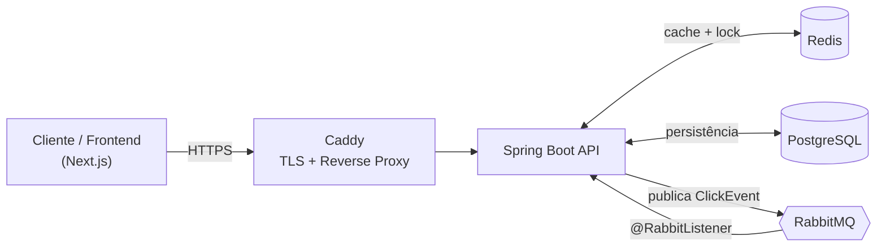
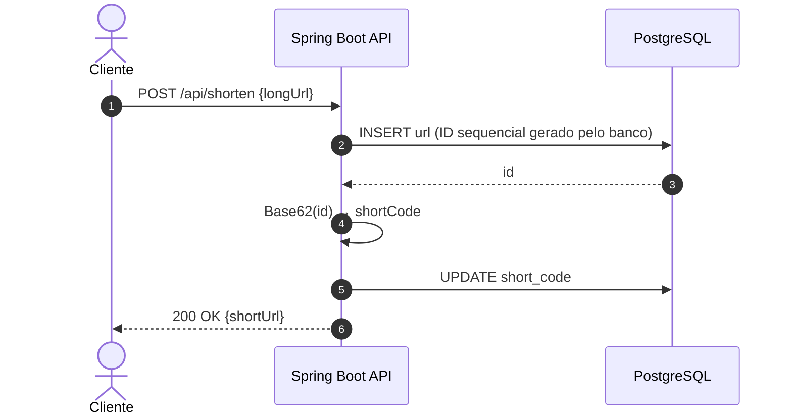
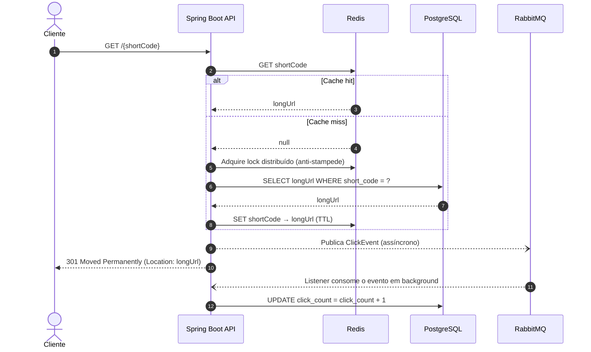
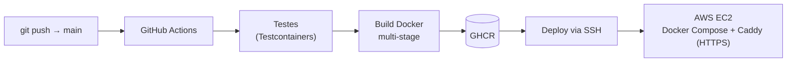

# url-shortener-api


API RESTful de encurtamento de URLs projetada para **baixa latência no redirecionamento**, **escrita desacoplada de métricas** e **resiliência sob tráfego concorrente**. O projeto é um estudo prático de arquitetura backend distribuída: cache-aside, mensageria assíncrona, locks distribuídos, testes de integração com infraestrutura real e entrega contínua.

| | |
| :--- | :--- |
| 🚀 **API em Produção (Swagger UI)** | [api.url-shortener.siyfred.dev/swagger-ui](https://api.url-shortener.siyfred.dev/swagger-ui/index.html) |
| 🖥️ **Frontend em Produção (Next.js)** | [url-shortener.siyfred.dev](https://url-shortener.siyfred.dev) |
| 📁 **Frontend (Repositório)** | [github.com/siyFred/url-shortener-web](https://github.com/siyFred/url-shortener-web) |

## Sumário

- [Destaques](#destaques)
- [Arquitetura](#arquitetura)
- [Decisões técnicas](#decisões-técnicas)
- [Trade-offs e pontos de atenção](#trade-offs-e-pontos-de-atenção)
- [Stack](#stack)
- [API](#api)
- [Executando localmente](#executando-localmente)
- [Testes](#testes)
- [CI/CD e deploy](#cicd-e-deploy)
- [Organização dos repositórios](#organização-dos-repositórios)
- [Roadmap](#roadmap)

---

## Destaques

- **Redirecionamento sem tocar o banco** no happy path: cache-aside com Redis.
- **Zero verificação de colisão**: o código curto é derivado deterministicamente do ID sequencial (Base62).
- **Analytics fora do caminho crítico**: cliques são publicados no RabbitMQ e contabilizados de forma assíncrona.
- **Proteção contra cache stampede** com lock distribuído em links recém-criados e muito acessados.
- **Testes com infraestrutura real**: PostgreSQL, Redis e RabbitMQ via Testcontainers, também no CI.
- **Deploy automatizado** do push na `main` até a instância EC2, com HTTPS gerenciado pelo Caddy.

---

## Arquitetura

### Visão geral dos componentes



### Fluxo de escrita (criação do link)



### Fluxo de leitura (redirecionamento e analytics)



> O usuário recebe o redirecionamento **antes** de a contagem de cliques ser persistida: a latência da rota crítica não depende do `UPDATE`.

---

## Decisões técnicas

| Decisão | Motivação | Custo |
| :--- | :--- | :--- |
| **Base62 derivado do ID sequencial** | Elimina colisões por construção; dispensa checagem no banco antes do `INSERT` e produz códigos curtos. | Códigos previsíveis (ver [trade-offs](#trade-offs-e-pontos-de-atenção)). Alternativas: hash truncado ou UUID, que exigem tratamento de colisão. |
| **Cache-aside com Redis** | Em *cache hit*, o `301` é devolvido sem abrir conexão de leitura no PostgreSQL. | Janela de inconsistência controlada por TTL. |
| **Lock distribuído no *cache miss*** | Evita *cache stampede*: muitas requisições simultâneas ao mesmo link ainda não cacheado não derrubam o banco. | Complexidade adicional e dependência do Redis. |
| **Contagem de cliques via RabbitMQ** | Incrementar o contador a cada acesso geraria contenção de linha (*row-level locking*) em URLs populares. O controller só publica a mensagem e encerra a requisição. | Contagem eventualmente consistente. |
| **Testcontainers em vez de mocks de infraestrutura** | Valida serialização de mensagens, queries e integração real com Redis/RabbitMQ no mesmo pipeline do CI. | Testes mais lentos que puramente unitários e dependentes de Docker. |
| **Imagem Docker multi-stage + GHCR** | Imagem final enxuta e artefato versionado e reproduzível. | Exige gerenciamento de credenciais do registry no CI. |

---

## Trade-offs e pontos de atenção

Registro das limitações conhecidas e de possíveis evoluções arquiteturais:

- **`301` é cacheado pelo navegador.** Após o primeiro acesso, o mesmo navegador pode redirecionar sem consultar a API, o que **subestima a contagem de cliques**. Usar `302`/`307` troca esse ganho de cache no cliente por analytics mais fiel.
- **IDs sequenciais geram códigos enumeráveis.** Alguém pode percorrer links criados por outros. Mitigações possíveis: embaralhar o alfabeto Base62, usar uma biblioteca de ofuscação de IDs (ex.: Sqids) ou aplicar rate limiting (ver [Roadmap](#roadmap)).
- **Criação em duas etapas (`INSERT` + `UPDATE`).** O `shortCode` depende do ID gerado pelo banco, então ambas as escritas devem ocorrer na mesma transação para não deixar registros sem código.
- **Entrega de mensagens *at-least-once*.** Reentregas do RabbitMQ podem incrementar o contador mais de uma vez; idempotência por evento e *dead-letter queue* são evoluções naturais.
- **`clickCount` é eventualmente consistente.** Lê-lo imediatamente após o redirecionamento pode retornar um valor ainda não atualizado.

---

## Stack

| Camada | Tecnologias |
| :--- | :--- |
| **Core** | Java 21, Spring Boot 3, Spring Data JPA (Hibernate), Maven |
| **Dados e mensageria** | PostgreSQL 17, Spring Data Redis (Redis 8), Spring AMQP (RabbitMQ 3.13) |
| **Testes** | JUnit 5, Mockito, Testcontainers |
| **Infraestrutura** | Docker, Docker Compose, Caddy, GitHub Actions, GHCR, AWS EC2 |
| **Documentação da API** | OpenAPI / Swagger UI |

---

## API

A documentação interativa completa está no [Swagger UI](https://api.url-shortener.siyfred.dev/swagger-ui/index.html).

### `POST /api/shorten` — Encurtar URL

```bash
curl -X POST https://api.url-shortener.siyfred.dev/api/shorten \
  -H "Content-Type: application/json" \
  -d '{"longUrl": "https://github.com/siyFred"}'
```

**Resposta (`200 OK`):**

```json
{
  "shortUrl": "https://api.url-shortener.siyfred.dev/aB3x9"
}
```

### `GET /{shortCode}` — Redirecionar

```bash
curl -i https://api.url-shortener.siyfred.dev/aB3x9
```

| Status | Descrição |
| :--- | :--- |
| `301 Moved Permanently` | Redireciona para a URL original (header `Location`) e publica o evento de clique. |
| `404 Not Found` | `shortCode` inexistente. |

---

## Executando localmente

### Pré-requisitos

- Docker e Docker Compose
- JDK 21 (opcional, apenas para rodar fora do container)

### Opção 1 — Stack completa (API + Postgres + Redis + RabbitMQ)

```bash
git clone https://github.com/siyFred/url-shortener-api.git
cd url-shortener-api
docker compose up --build
```

- API: `http://localhost:8080`
- Swagger UI: `http://localhost:8080/swagger-ui/index.html`

### Opção 2 — Apenas a infraestrutura, com a API pela IDE

```bash
docker compose up -d postgres redis rabbitmq
./mvnw spring-boot:run
```

### Variáveis de ambiente

Os valores padrão em `src/main/resources/application.yaml` já funcionam para o ambiente local:

| Variável | Descrição | Padrão (local) |
| :--- | :--- | :--- |
| `DB_URL` | JDBC URL do PostgreSQL | `jdbc:postgresql://localhost:5432/urlshortener_db` |
| `DB_USERNAME` | Usuário do banco | `postgres` |
| `DB_PASSWORD` | Senha do banco | `postgres` |
| `SPRING_DATA_REDIS_HOST` | Host do Redis | `localhost` |
| `SPRING_RABBITMQ_HOST` | Host do RabbitMQ | `localhost` |
| `APP_BASE_URL` | Domínio base usado para montar o link curto | `http://localhost:8080` |

---

## Testes

```bash
./mvnw clean test
```

> Requer Docker ativo, pois o Testcontainers sobe as instâncias reais de PostgreSQL, Redis e RabbitMQ.

| Tipo | Ferramentas | O que valida |
| :--- | :--- | :--- |
| **Unitários** (camada de serviço) | JUnit 5 + Mockito | Cenários de *cache hit/miss* e formatação de URLs, de forma isolada. |
| **Integração** | JUnit 5 + Testcontainers | Queries reais no PostgreSQL, comportamento do Redis e serialização/consumo de mensagens no RabbitMQ. |

A mesma suíte roda no pipeline de CI a cada push.

---

## CI/CD e deploy



A cada push na `main`, o pipeline executa os testes, constrói a imagem, publica no GitHub Container Registry e atualiza os containers na instância EC2 por SSH. O certificado TLS é emitido e renovado automaticamente pelo Caddy.

---

## Organização dos repositórios

O projeto segue uma abordagem **multirepo**, com ciclos de vida e deploys independentes:

| Repositório | Responsabilidade |
| :--- | :--- |
| [`url-shortener-api`](https://github.com/siyFred/url-shortener-api) (este) | Regras de negócio, persistência, cache, mensageria e infraestrutura de deploy. |
| [`url-shortener-web`](https://github.com/siyFred/url-shortener-web) | Interface web em Next.js que consome esta API. |

---

## Roadmap

- [ ] Autenticação stateless com Spring Security (JWT) para gestão de links por usuário.
- [ ] Listagem paginada e remoção de links (`GET /api/links`, `DELETE /api/links/{id}`).
- [ ] Rate limiting por IP na criação de links, usando Redis.
- [ ] Idempotência no consumo de eventos de clique e *dead-letter queue*.
- [ ] Métricas e observabilidade (Micrometer + Prometheus/Grafana).
- [ ] Testes de carga (ex.: k6) com resultados publicados neste README.

---

## Autor

Desenvolvido por [**siyFred**](https://github.com/siyFred).
